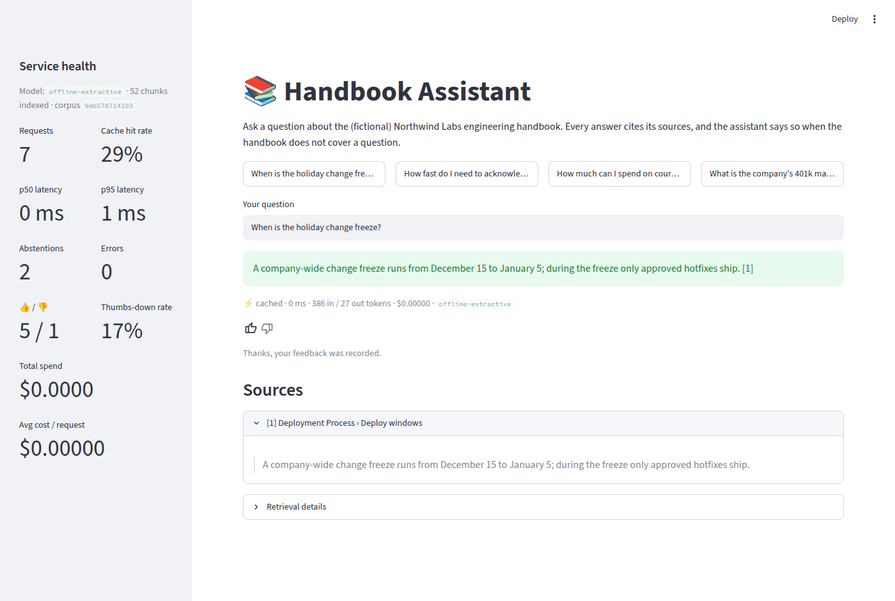
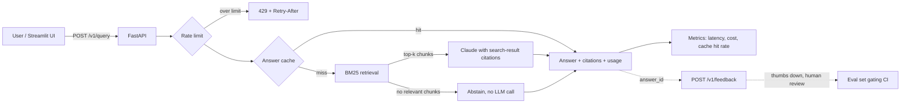

# Production RAG Service

[](https://github.com/tsriharsha402/production-rag-service/actions/workflows/ci.yml)


A question-answering API over internal documents, built the way it would need to be built
to run in production: grounded answers with verifiable citations, an evaluation suite that
gates every change in CI, caching, rate limiting and per-request cost tracking.

## Executive summary

| | |
|---|---|
| **Problem** | Employees lose time searching policy docs, and generic chatbots answer confidently from outside knowledge, sometimes wrongly. |
| **Solution** | A retrieval-augmented API that answers only from the company's documents, cites the exact supporting text, and says "I don't know" when the documents don't cover a question. |
| **Quality** | 46-question evaluation set runs in CI on every change. With Claude, 84.8% of questions pass and it never answered a question the documents can't answer (see [Evaluation](#evaluation)). |
| **Cost control** | Cost is tracked per request, and a daily spend cap stops new paid answers once the day's budget is used. Repeated questions are served from cache for $0, and questions with no relevant documents are answered without calling the model. |
| **Improvement loop** | Users rate answers with a thumbs up or down. Thumbs-down answers become draft eval cases that a reviewer labels and promotes into the CI gate, so the eval set grows from real failures (see [Feedback loop](#feedback-loop)). |
| **Risk control** | Verifiable citations, explicit abstention, rate limiting per client, no secrets in code, refusal fallback, decision records for every major tradeoff. |


<sub>The Streamlit UI running in offline mode (no API key): answer with citation and source quote, thumbs up/down feedback, and live service metrics including thumbs-down rate.</sub>

## Architecture



| Component | Choice | Why |
|---|---|---|
| API | FastAPI + Pydantic | Typed request/response contracts, OpenAPI docs at `/docs` |
| Retrieval | BM25 over section-aware chunks | Zero infrastructure, a strong baseline ([ADR 0001](docs/decisions/0001-start-with-bm25-retrieval.md)) |
| Generation | Claude (`claude-opus-5-5`) with `search_result` blocks | Every citation quotes a retrieved chunk verbatim ([ADR 0004](docs/decisions/0004-grounding-citations-and-model-choice.md)) |
| Offline mode | Deterministic extractive baseline | Tests and CI need no API key ([ADR 0002](docs/decisions/0002-provider-interface-with-offline-baseline.md)) |
| Cache | In-memory LRU+TTL, or Redis | Invalidated automatically when documents, the prompt, or model or retrieval settings change ([ADR 0003](docs/decisions/0003-exact-match-answer-cache.md)) |
| Rate limiting | Token bucket per client IP, proxy-aware; ignores client-supplied identity headers | Protects the API budget from runaway clients |
| Spend cap | Daily USD budget across all clients, shared via Redis across replicas ([ADR 0006](docs/decisions/0006-daily-spend-cap.md)) | Bounds the worst-case bill, even from many clients at once; cached answers keep working when it's reached |
| Observability | Structured JSON logs, request IDs, `/v1/metrics` | p50/p95 latency, spend, cache hit rate, abstentions, thumbs-down rate |
| Feedback | Thumbs up/down per `answer_id`, stored server-side; thumbs-down → reviewed eval cases ([ADR 0007](docs/decisions/0007-feedback-loop-into-evals.md)) | The eval set learns from production instead of only from what the team thought to ask |

## Quickstart

**1. Offline, no API key (about 1 minute)**

```bash
git clone https://github.com/tsriharsha402/production-rag-service
cd production-rag-service
python -m venv .venv && source .venv/bin/activate
make install
make run          # API on http://localhost:8000, docs at /docs
make ui           # in a second terminal: UI on http://localhost:8501
```

**2. With Claude**

```bash
cp .env.example .env      # then set ANTHROPIC_API_KEY in .env
set -a && source .env && set +a
make run
```

**3. Docker (API + UI + Redis)**

```bash
cp .env.example .env      # optional: add ANTHROPIC_API_KEY
docker compose up --build
```

## API

```bash
curl -s localhost:8000/v1/query \
  -H 'content-type: application/json' \
  -d '{"question": "When is the holiday change freeze?"}'
```

```json
{
  "answer_id": "8877711113a34a41b990daf6477da9c0",
  "answer": "A company-wide change freeze runs from December 15 to January 5; during the freeze only approved hotfixes ship. [1]",
  "abstained": false,
  "cached": false,
  "citations": [
    {
      "ref": 1,
      "chunk_id": "deployment-process#1",
      "doc_id": "deployment-process",
      "title": "Deployment Process",
      "section": "Deploy windows",
      "quote": "A company-wide change freeze runs from December 15 to January 5; during the freeze only approved hotfixes ship."
    }
  ],
  "retrieved": [
    {"ref": 1, "chunk_id": "deployment-process#1", "doc_id": "deployment-process", "title": "Deployment Process", "section": "Deploy windows", "score": 6.66}
  ],
  "usage": {"model": "offline-extractive", "input_tokens": 176, "output_tokens": 27, "cost_usd": 0.0, "latency_ms": 0.7}
}
```

<sub>Response from offline mode, abbreviated. With Claude, `answer` is a written response with `[n]` markers and `usage` reports real token counts and cost.</sub>

| Endpoint | Purpose |
|---|---|
| `POST /v1/query` | Answer a question. Returns 429 with `Retry-After` when rate limited, 503 when the model API is unavailable, and 503 with `Retry-After` (seconds to midnight UTC) when the daily budget is used up. |
| `POST /v1/feedback` | Rate an answer: `{"answer_id": "...", "rating": "up" \| "down", "comment": "optional"}`. Returns 201, or 404 if the id is unknown or older than the rating window (7 days). The latest vote per answer counts. |
| `GET /v1/metrics` | Requests, cache hit rate, abstentions, errors, budget rejections, p50/p95 latency, tokens, total and average cost, spend today and budget remaining, thumbs up/down and thumbs-down rate |
| `GET /healthz` | Provider, model, number of indexed chunks, corpus version, cache namespace |

## Evaluation

[`evals/dataset.jsonl`](evals/dataset.jsonl) has 46 questions about the sample handbook:
33 direct questions, 8 deliberately paraphrased "hard" questions, and 5 questions the
documents cannot answer. Each answerable question lists the document that should be cited
and the facts the answer must contain.

| Metric | What it measures |
|---|---|
| Retrieval hit@1 / hit@k / MRR | Did retrieval surface the right document, and how high? |
| Context recall | Did the text sent to the model contain every required fact? Stricter than hit@k: the right document's wrong section passes hit@k but leaves nothing to answer from |
| Answer keyword recall | Does the answer contain the required facts? |
| Citation accuracy | Does the answer cite the right document? |
| False abstention rate | How often it says "I don't know" when the answer is in the documents |
| Abstention accuracy | How often it correctly says "I don't know" when the answer isn't |
| Cost and latency | Total and per-question cost, p50/p95 latency |

**Offline baseline** (measured, runs in CI on every push; full report in [`evals/results/offline.md`](evals/results/offline.md)):

| Retrieval hit@1 | Retrieval hit@k | MRR | Context recall | Keyword recall | Citation accuracy | Abstention accuracy |
|---|---|---|---|---|---|---|
| 90.2% | 97.6% | 0.920 | 92.7% | 61.0% | 78.0% | 80.0% |

The retrieval numbers apply to every configuration. The answer numbers are a floor from
a deliberately simple extractive baseline, not the product's quality. CI fails the build
if retrieval hit@k drops below 90%, context recall below 90%, keyword recall below 55% or
abstention accuracy below 60%, so a regression in chunking or retrieval can't merge silently.

**With Claude** (`claude-opus-5-5`, effort medium; measured 2026-10-05 with `make eval-live`;
full report in [`evals/results/claude-opus-5-5.md`](evals/results/claude-opus-5-5.md)):

| Pass rate | Keyword recall | Citation accuracy | False abstention | Abstention accuracy | Cost per question | Latency p50 / p95 |
|---|---|---|---|---|---|---|
| 84.8% | 82.9% | 82.9% | 17.1% | 100.0% | $0.0093 | 3.2s / 6.3s |

The full run cost $0.43. Claude never invented an answer: it abstained on all 5 unanswerable
questions. All 7 failures are "I don't know" answers to answerable questions, and in every
one the required fact was not in the retrieved chunks. Retrieval found the right *document*
but the wrong *section* (6 cases) or nothing above the score threshold (1 case). The
doc-level hit@k of 95.1% overstates retrieval: only 82.9% of answerable questions get the
chunk that contains the answer. Retrieval, not the model, is the bottleneck.

**Since this run:** retrieval now sends 8 chunks instead of 4
([ADR 0005](docs/decisions/0005-retrieve-eight-chunks.md),
[experiment](evals/results/retrieval-experiment.md)), raising context recall from 82.9% to
92.7%. That puts the answer in front of the model for 4 of the 7 failed questions. The other 3
share no vocabulary with their answers and need semantic search
([issue #2](https://github.com/tsriharsha402/production-rag-service/issues/2)). The Claude
numbers above are from the 4-chunk run; a re-run with `make eval-live` is pending.

### Feedback loop

The eval set above was written by hand. Real users ask other questions, in other words,
and those are the ones it misses. Feedback closes that gap
([ADR 0007](docs/decisions/0007-feedback-loop-into-evals.md)):

1. Every answer has an `answer_id`; the UI shows thumbs up/down and, after a thumbs down,
   asks what was wrong.
2. The API stores each vote with its own record of the question, answer and sources, so the
   evidence can't be tampered with by the client.
3. `make feedback-draft` turns thumbs-down votes into candidates in `evals/candidates.jsonl`:
   grouped by question, skipping ones the dataset already covers, most complaints first,
   each with a triage hint.
4. A reviewer labels each candidate (`answerable`, `expected_doc`, `expected_keywords`), and
   `make feedback-promote` validates the labels against the corpus and appends the cases to
   `evals/dataset.jsonl`. From then on CI tests that question on every change.

```json
{"id": "fb-479605ad", "question": "Can I bring my dog to the office?", "answerable": null,
 "expected_doc": null, "expected_keywords": [],
 "review": {"thumbs_down": 1, "abstained": true, "retrieved_docs": ["expense-policy"],
            "triage": "Abstained although documents were retrieved. If the answer is in them, generation was too cautious; if it's elsewhere in the handbook, retrieval missed it. If the handbook doesn't cover it, the abstention was right: set answerable=false."}}
```

Candidates are never promoted automatically. A thumbs down says something went wrong, not
what right looks like, and a user who dislikes a correct "I don't know" shouldn't teach the
CI gate to reward guessing.

## Cost model

Cost is computed per request from the token usage the API returns
([`pricing.py`](src/rag_service/pricing.py)) and aggregated at `/v1/metrics`.

Measured for `claude-opus-5-5` at effort medium ($4 input / $20 output per million tokens).
Token averages come from the same request in
[llm-model-selection](https://github.com/tsriharsha402/llm-model-selection) (run 2026-10-05);
the cost per question is from `make eval-live`:

| Measure | Value |
|---|---|
| Input per question (system prompt + 4 search results + question) | ~1,490 tokens → $0.0060 |
| Output per question (answer + reasoning) | ~180 tokens → $0.0036 |
| **Cost per uncached question** (measured, 46 questions) | **$0.0093** |
| 1,000 questions/day at a 30% cache hit rate | ~$6.50/day, ~$200/month |

Input tokens are about 60% of the cost, so the cheapest levers are fewer or shorter chunks
per request and prompt caching for the fixed system prompt. Lowering `LLM_EFFORT` saves less
than expected: effort low cost 5% less than medium in the model-selection run.
Whether a cheaper configuration holds quality on this task is measured in the companion
project [llm-model-selection](https://github.com/tsriharsha402/llm-model-selection).

The levers, in order: caching (free), abstaining without an LLM call (free), lowering
`LLM_EFFORT`, then a smaller model if the evaluation suite shows quality holds.
`DAILY_BUDGET_USD` (default $10/day) is the backstop: whatever the traffic, the worst-case
daily bill is bounded, and an 80% warning is logged before the cap is hit.

## Design decisions

- [0001: Start with BM25 lexical retrieval](docs/decisions/0001-start-with-bm25-retrieval.md)
- [0002: Provider interface with an offline baseline](docs/decisions/0002-provider-interface-with-offline-baseline.md)
- [0003: Exact-match answer cache before a semantic cache](docs/decisions/0003-exact-match-answer-cache.md)
- [0004: Grounded answers with native citations; model defaults](docs/decisions/0004-grounding-citations-and-model-choice.md)
- [0005: Retrieve 8 chunks instead of 4](docs/decisions/0005-retrieve-eight-chunks.md)
- [0006: Daily spend cap that degrades gracefully](docs/decisions/0006-daily-spend-cap.md)
- [0007: User feedback feeds the evaluation set, through human review](docs/decisions/0007-feedback-loop-into-evals.md)

## Limitations

- **Lexical retrieval** misses paraphrases with no shared words. It is the main source of
  retrieval failures in the evaluation set.
- **Single-turn only.** No conversation history or follow-up questions.
- **No authentication.** Rate limiting is per client IP address (set `TRUSTED_PROXY_HOPS`
  when running behind a load balancer). Put it behind an API gateway or SSO before
  exposing it, and rate-limit on the authenticated user instead.
- **In-process metrics** reset on restart and are per replica. Production would export
  them to Prometheus or OpenTelemetry.
- **Feedback is user data.** It holds users' questions and comments, isn't exposed over
  the API, and needs a retention policy before real use. The file backend is single-node;
  use `CACHE_BACKEND=redis` for several replicas.
- **Small evaluation set.** 46 questions catch regressions but aren't enough to compare
  close configurations with statistical confidence.

## Roadmap

- [x] Publish Claude evaluation results (`make eval-live`) next to the baseline
- [x] User feedback that feeds the evaluation set, through human review
- [ ] Hybrid retrieval: BM25 + embeddings in PostgreSQL/pgvector, kept only if hit@1 improves
- [ ] OpenTelemetry tracing across retrieval and generation
- [ ] Streaming responses for lower perceived latency
- [ ] Semantic cache for paraphrased questions, with a measured wrong-hit rate
- [ ] LLM-graded answer quality to complement keyword recall

## What I'd do with a team of four

| Role | First 90 days |
|---|---|
| **Retrieval engineer** | Hybrid retrieval on pgvector, grow the evaluation set to 300+ questions from real (anonymized) user queries |
| **Platform engineer** | Auth via SSO, OpenTelemetry, Prometheus dashboards and alerting, autoscaling |
| **Full-stack engineer** | Chat UI with conversation history, a review queue for feedback candidates instead of editing JSONL |
| **Applied AI engineer** | LLM-graded evaluations, model and effort tuning for cost, prompt-injection testing |

My role: own the roadmap and the quality bar (no model, prompt or retrieval change ships
without evaluation results), run the AI risk review with security and legal, and report
adoption, answer quality and cost per answer to stakeholders every month.

## Project structure

```
src/rag_service/
  api.py          FastAPI app, middleware, error mapping
  pipeline.py     cache → retrieve → abstain or generate → cite
  retrieval.py    BM25 index
  documents.py    markdown loading and section-aware chunking
  llm.py          Claude provider and offline baseline
  cache.py        in-memory and Redis answer caches
  rate_limit.py   per-client token bucket
  metrics.py      latency, cost, cache and feedback metrics
  feedback.py     answer records and thumbs up/down storage (file or Redis)
  pricing.py      per-model token prices
  evaluation.py   evaluation metrics and report
evals/            dataset, runner, feedback-to-eval script, published results
ui/               Streamlit front end
data/handbook/    sample corpus (fictional company handbook)
docs/decisions/   architecture decision records
tests/            unit and API tests (no API key needed)
```

## License

[MIT](LICENSE)
